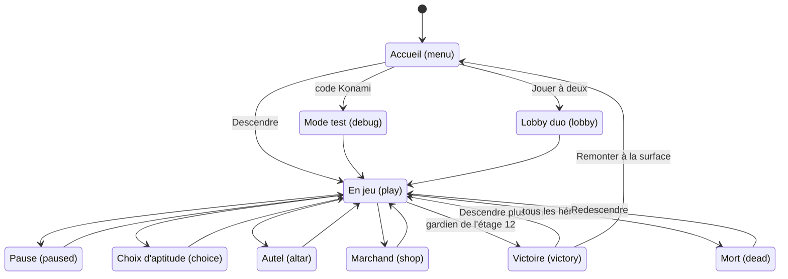

# Les Profondeurs

Dungeon crawler 3D en navigateur, solo ou à deux sur le même écran. [Jouer sur GitHub Pages](https://k1n0b0n.github.io/les-profondeurs/).

## Vue d'ensemble

Les Profondeurs est un dungeon crawler 3D en vue plongeante, solo ou à deux sur le même écran, tenu dans un seul fichier `index.html` d'environ 9 400 lignes (380 Ko). Le but : descendre jusqu'à −144 m, soit 12 étages, en abattant les quatre gardiens qui scellent l'escalier tous les trois étages.

- **Moteur** : three.js 0.170.0, importé en module ES depuis jsDelivr. Aucune autre dépendance, aucun build, aucun fichier d'asset.
- **Tout est procédural** : textures dessinées sur `<canvas>`, modèles assemblés à partir de primitives (cylindres, sphères, cônes), bruitages synthétisés en WebAudio, musique chiptune composée note à note dans le code.
- **Plateformes** : navigateur de bureau (clavier, souris, manette) et mobile (joystick tactile, attaque auto activée par défaut sur écran tactile).
- **Persistance** : `localStorage` uniquement, sous des clés `profondeurs.*` (record, grimoire, pactes, réglages).
- **Hébergement** : dépôt [k1n0b0n/les-profondeurs](https://github.com/k1n0b0n/les-profondeurs), publié sur GitHub Pages.

Le projet n'a ni tests automatisés ni `package.json`.

## Organisation du dépôt

Le dépôt tient en trois fichiers : `index.html`, ce `README.md` et un `.gitignore` qui exclut `.serena/`, `.playwright-mcp/`, `node_modules/` et les fichiers d'OS.

`index.html` se lit en quatre blocs :

| Lignes | Bloc | Contenu |
| --- | --- | --- |
| 1–474 | `<head>` + `<style>` | Métas mobiles (viewport-fit cover), polices Google (Alegreya Sans, IM Fell English SC), tout le CSS du HUD et des menus |
| 476–694 | HTML | Canevas 3D `#scene`, HUD `#hud` (bandeau de gardien, bandeau d'épreuve, clé d'os), contrôles tactiles, et 10 overlays : accueil, mode test, duo, choix d'aptitude, autel, marchand, pause, victoire, mort |
| 696–716 | Script classique | Filet de démarrage : affiche une erreur si three.js ne charge pas ou si le jeu n'a pas signalé `window.__profondeursReady` après 15 s |
| 717–9438 | `<script type="module">` | Tout le jeu, découpé en sections `// ---------- Nom` |

Les sections du module, dans l'ordre du fichier :

| Lignes | Section | Rôle |
| --- | --- | --- |
| 717–844 | Constantes | Tuile, vitesses, cadences, keymaps, classes, helpers (`rand`, `clamp`, `hpScale`, `dmgScale`), wrapper `store` sur localStorage |
| 845–1123 | Rendu | Renderer, scène, lumières, textures canvas, géométries `G` et matériaux `M` partagés |
| 1124–1215 | Héros | Modèle 3D des héros (`buildHero`), anneaux de garde et d'esquive prête |
| 1216–1560 | Monstres | `ENEMIES`, `BIOMES`, escouades (`SQUADS`, `rollSquad`), `rollEnemy`, modèles 3D des monstres et gardiens |
| 1561–1621 | Particules | Pool `InstancedMesh` de 420 particules (`burst`, `ring`) |
| 1622–1770 | Génération du donjon | BFS, `tryGenerate`, `generateDungeon`, salle secrète |
| 1771–2036 | Niveau | Objet global `L`, `buildLevel`, escalier, `populate` (escouades, élites, chambre forte, stèle) |
| 2037–2291 | Pièges : placement | Plaques, bouches de feu, lames, fléchettes, barils |
| 2292–2958 | Biomes : placement et effets | Lave, glace, stalactites et rochers, sarcophages, champignons, nuages, affixes, `spawnEnemy`, butin |
| 2959–3122 | Collisions, vision | Collisions par tuile, ligne de vue, brouillard (`reveal`), champ de flux des monstres |
| 3123–3246 | Son | Contexte WebAudio, `tone`, `hiss`, table `sfx` |
| 3247–3506 | Musique | `THEMES` par biome, séquenceur chiptune |
| 3507–3596 | Aptitudes et reliques | `PERKS`, rareté, grimoire, tirage `rollPerks` |
| 3597–5207 | Joueur | Stats, équipement, déplacements, esquive, parade, attaques, combo, Transe, salle secrète, chambre forte, stèles, dégâts, mort, réanimation |
| 5208–5349 | Fin de partie, pactes, grimoire | Victoire, `PACTS`, record, écran de mort |
| 5350–5692 | Monstres : IA | Une fonction `ai*` par type, dont porte-bouclier, psalmodieur et artificier |
| 5693–6926 | Gardiens | `BOSSES`, paquet d'attaques, phases, dangers de désespoir, attaques |
| 6927–7282 | Pièges : comportement | Mise à jour des pièges, embuscades en deux vagues |
| 7283–7524 | Objets, autel, escalier | Ramassage, coffres, clé d'os, chambre forte, stèles, descente |
| 7525–7909 | Choix, autel, menus | Overlays d'aptitude, autel, marchand, pause |
| 7910–8193 | HUD | Barres, minicarte, toasts, combo, recharges d'esquive et de parade |
| 8194–8359 | Héros, lumière, caméra | Animation des héros, torches, caméra |
| 8360–8693 | Commandes | Clavier, souris, tactile, garde maintenue |
| 8694–8826 | Deux joueurs | Menu duo, attribution des appareils |
| 8827–8905 | Mode test | Code Konami, choix du biome et de l'étage |
| 8906–9211 | Manette | Gamepad API |
| 9212–9258 | Fluidité | Qualité adaptative |
| 9259–9438 | Boucle | `requestAnimationFrame`, ordre des mises à jour, démarrage |

## Architecture technique

Le jeu repose sur un état global mutable au niveau du module, sans framework ni classes : des objets littéraux, des tableaux et une machine à états en chaîne de caractères (`state`).

### État global

| Variable | Rôle |
| --- | --- |
| `state` | Écran courant : `menu`, `debug`, `lobby`, `play`, `paused`, `choice`, `altar`, `shop`, `victory`, `dead` |
| `L` | L'étage en cours : grille 44 × 44 (`Uint8Array`, 1 = sol), meshes, ennemis, objets, pièges, tirs, cases vues. Reconstruit à chaque étage par `buildLevel`, libéré par `disposeLevel` |
| `heroes` | 1 ou 2 héros. Stats, aptitudes (`perks`), équipement (`gear`), PV, potions, or |
| `player` | Le héros en cours de mise à jour. Beaucoup de fonctions le lisent implicitement : la boucle l'affecte à chaque héros puis le remet sur `heroes[0]` |
| `team` | Niveau, XP et gardiens vaincus, partagés. Exposés sur chaque héros par des getters (`HeroProto`) |
| `combo`, `transe` | Compteur de combo et minuteur de Transe, communs à l'équipe |
| `run` | Partie en cours : victoire obtenue, pactes actifs |
| `grimoire` | Ce qui survit d'une partie à l'autre : reliques débloquées, victoires, pacte le plus lourd remporté |

### Unités et échelles

- Une tuile mesure 2 unités (`TILE`), un mur 1,5 de haut. Le héros a un rayon de 0,36 et court à 5,4 unités/s.
- Les PV et dégâts sont stockés en dixièmes : un héros a 10 PV en interne, affichés « 100 ». La fonction `D(v)` fait la conversion. Les textes d'aptitudes parlent donc en unités affichées (« 10 PV » = `heal(1)`).
- Les monstres montent avec la profondeur : PV × `hpScale` = 1 + 0,2 par étage, dégâts × `dmgScale` = 1,25 + 0,12 par étage, vitesse + 4 % par étage (plafond à l'étage 9). Après l'étage 6, une accélération au carré s'ajoute (`deep`) : PV × 3,6 et dégâts × 2,9 à l'étage 10, contre × 2,8 et × 2,3 avant.

### Rendu

- Murs, sols, lave et glace sont des `InstancedMesh` : un appel de dessin par type de case. Les murs n'ont que deux groupes de faces (côtés, dessus) au lieu de six.
- Le brouillard de guerre passe par la couleur d'instance : une case non vue reste noire. `reveal()` éclaire les cases en ligne de vue (rayon 6, 4 en Champignonnière) à chaque changement de case du héros, et dessine la minicarte au passage.
- Géométries (`G`) et matériaux (`M`) sont partagés ; les ressources propres à un étage vont dans `L.disposables`.
- Les particules sont un pool `InstancedMesh` de 420 cubes.
- Les shaders sont précompilés au démarrage (`warmShaders`, avec `KHR_parallel_shader_compile` si disponible) pour éviter les saccades au premier effet.

### IA et déplacements

- Collisions par tuile (`collides`, `moveAxis`), ligne de vue par échantillonnage tous les 0,4 (`los`).
- Les monstres suivent un champ de flux : un BFS part des cases des héros debout (`computeFlow`, profondeur 28). Ils foncent droit sur le héros quand ils le voient sans lave entre eux, sinon ils descendent le champ.

### Son et musique

- Bruitages synthétisés en WebAudio : `tone` (oscillateur avec glissando), `hiss` (bruit filtré). La table `sfx` regroupe une cinquantaine d'effets, limités par `throttled`.
- Musique : un séquenceur à 16 pas (12 pour la glace) tourne sur un `setInterval` de 25 ms et planifie 150 ms d'avance. Chaque biome a son thème dans `THEMES` (tempo, accords, mélodie, basse, arpège, batterie). Le tempo accélère quand un gardien est éveillé, et pendant le combat de gardien comme pendant la Transe, la mélodie monte de 10 % et la batterie passe en motif intense.

### Temps et fluidité

- `dt` est plafonné à 0,05 s. Un impact gèle le temps à × 0,2 (`hitStop`), le ralenti à × 0,35 (`slowMo`).
- La qualité s'adapte seule : 5 crans de pixel ratio (de 1 à 0,5 × `DPR_MAX`, plafonné à 2). Le jeu baisse d'un cran sous 50 i/s et remonte au-dessus de 57 i/s tenus 5 fenêtres de 60 images. Le cran retenu est mémorisé.
- Sur écran tactile, les images sont plafonnées à environ 60 i/s ; en menu ou en pause, le rendu tombe à 10 i/s.

### Démarrage et persistance

`boot()` lit les réglages, prépare la scène, puis lance `renderer.setAnimationLoop(loop)`. Si l'API de rechargement à chaud de l'hôte (`window.claude.hot`) est présente, `snapshot()` lui confie la partie en cours, qui reprend en pause au rechargement. Sur GitHub Pages, cette API n'existe pas : recharger la page abandonne la partie.

| Clé `localStorage` | Contenu |
| --- | --- |
| `profondeurs.best` | Meilleure partie |
| `profondeurs.grimoire` | Reliques débloquées, victoires, pacte le plus lourd |
| `profondeurs.pactes` | Pactes cochés à l'accueil |
| `profondeurs.hero` | Héros solo choisi |
| `profondeurs.layout` | Clavier droitier ou gaucher |
| `profondeurs.attaque-auto` | Attaque auto |
| `profondeurs.music`, `profondeurs.muted` | Musique, son |
| `profondeurs.rendu` | Cran de qualité retenu |
| `profondeurs.tuto-glisser` | Astuce tactile déjà vue |

## Boucle de jeu

Une partie gagnée traverse 12 étages répartis en 4 biomes de 3 étages ; le troisième étage de chaque biome est gardé par un boss. La Crypte ouvre toujours la descente, les trois autres biomes suivent dans un ordre tiré au hasard à chaque partie.

1. **Accueil** : choix du héros (La Lame ou L'Arbalétrière), solo ou duo. Après une première victoire, les pactes deviennent disponibles.
2. **Exploration d'un étage** : le donjon se dévoile autour de la torche. On tue les monstres, on casse jarres et caisses, on ouvre les coffres, et on cherche l'escalier, placé dans la salle la plus éloignée du départ.
3. **Rencontres** : marchand dans un refuge où personne ne se bat, autel qui échange des PV max contre un pouvoir, salle d'embuscade qui se referme sur le joueur, salle secrète derrière un mur fissuré, chambre forte fermée par une grille dorée dont il faut trouver la clé d'os, stèle d'épreuve qui lance un défi.
4. **Montée de niveau** : l'XP est commune. À chaque niveau, chaque héros choisit une aptitude parmi trois, ou passe et reprend 30 PV.
5. **Étage du gardien** (3, 6, 9, 12) : l'escalier est scellé, le gardien attend dans sa salle, une fontaine soigne dans la salle voisine. Le gardien tombé rouvre l'escalier, achève les monstres restants et offre une relique légendaire à chaque héros.
6. **Fin** : abattre le gardien de l'étage 12 (−144 m) gagne la partie. On peut alors « Descendre plus loin » (les biomes recommencent leur cycle, sans fin) ou « Remonter à la surface ». Si tous les héros tombent, la partie s'arrête sur un bilan.

Pause, choix, autel, marchand, lobby et victoire gèlent le monde (`FROZEN`). À l'accueil, en mode test et après la mort, le donjon continue de vivre sans le joueur. Depuis la victoire, « Descendre plus loin » revient à `play` ; depuis la mort, « Redescendre » relance une partie.

Le record classe les parties dans cet ordre : une victoire bat toute défaite, puis le nombre de pactes d'une victoire, puis la profondeur, puis les écus. Les parties du mode test ne comptent pas.

### Ce qui change d'un étage à l'autre

| Paramètre | Formule (`depth` = n° d'étage) |
| --- | --- |
| Salles | min(8 + depth, 14), au moins 5 |
| Monstres par étage | min(40, 13 + 2 × (depth − 1)), × 0,6 sur l'étage du gardien |
| Types de monstres | slime dès l'étage 1, rôdeur et sorcier dès 2, brute, porte-bouclier et artificier dès 3, psalmodieur dès 4 |
| Composition | 7 salles sur 10 reçoivent une escouade (un noyau + des troupes), les autres un tirage libre |
| Élites | aucune à l'étage 1, 35 % jusqu'à l'étage 3, puis 70 % + 20 % d'une 2e ; dès l'étage 7, 1 garantie + 60 % d'une 2e (+ 50 % d'une 3e dès l'étage 10), chacune à deux affixes |
| Embuscades | dès l'étage 2 : 1 salle, 2 dès l'étage 5, en deux vagues ; la seconde est menée par une élite dès l'étage 4 |
| Pièges | fléchettes et pointes dès 2, bouches de feu dès 3, lames tournoyantes dès 4, rochers dès 5 |
| Marchand | dès l'étage 2, garanti aux étages 2, 5, 8, 11, sinon 30 % |
| Autel | dès l'étage 2, 45 % |
| Salle secrète | toujours à l'étage 1, 50 % ensuite, jamais sur l'étage du gardien |
| Chambre forte | dès l'étage 2, 55 %, jamais sur l'étage du gardien |
| Stèle d'épreuve | dès l'étage 2, 45 %, jamais sur l'étage du gardien |

## Mécaniques de gameplay

Le combat récompense la lecture et le rythme : chaque attaque ennemie s'annonce, l'esquive évite tout, la parade punit les coups au contact, et enchaîner les victimes fait monter un combo qui déclenche la Transe. Toutes les valeurs ci-dessous sont en unités affichées (PV × 10).

### Héros

Les deux héros partent avec 100 PV, 2 potions sur 3 places (35 PV chacune), 8 % de critiques et un aimant à écus de 2,4. Ils courent à 5,4 unités/s.

|  | La Lame | L'Arbalétrière |
| --- | --- | --- |
| Attaque | Coup d'épée en arc de 70°, portée 1,9 | Carreau, portée 11, vitesse 19 |
| Cadence | 1 coup / 0,42 s | 1 tir / 0,5 s |
| Dégâts par coup | 100 % | 80 % |
| Visée | Se tourne vers l'ennemi visible le plus proche (rayon 3,4) | Automatique sur l'ennemi le plus proche, ou sur l'orbe qui arrive |
| Orbes ennemies | Les renvoie, comme les fléchettes des pièges : elles deviennent ses projectiles | Les abat en vol |

Les dégâts d'un coup valent `(1 + 0,1 × (niveau − 1)) × multiplicateur d'équipement`, × 1,25 en Transe. Un critique frappe double. Frapper un mur fissuré, une jarre, une caisse ou un baril les casse ; l'esquive casse aussi ce qu'elle traverse.

L'**attaque auto** (activée par défaut sur écran tactile) frappe seule dès qu'un ennemi est à portée ou qu'une orbe arrive. Dans le refuge du marchand, aucune attaque ne part (« Trêve du marchand »).

### Esquive, élan et critiques

- **Esquive** : 0,2 s de ruée à 15 unités/s, invulnérable 0,26 s, recharge 0,85 s. Un anneau bleu bref signale qu'elle est de nouveau prête.
- **Commandes mémorisées** : une esquive, une parade ou une attaque demandée un peu trop tôt (jusqu'à 0,16 s avant la fin d'une recharge, ou pendant une ruée) part dès que possible au lieu d'être perdue.
- **Esquive parfaite** : un coup encaissé dans les 0,12 premières secondes de l'esquive (0,16 s sur tactile) déclenche « Parfait ! » : ralenti de 0,45 s, prochain coup critique, recharge ramenée à 0,4 s. Plus tard dans l'esquive, le coup est évité sans bonus (« Esquivé »).
- **Frôlement** : sortir d'une zone (frappe au sol, explosion, onde, chute de pierre) en esquivant au dernier moment compte aussi comme une esquive parfaite.
- **Élan** : une attaque lancée moins de 0,35 s après la fin d'une esquive est un critique assuré. Le bouton d'attaque s'allume pendant ce temps.
- **Ennemis exposés** : un rôdeur, une brute ou un porte-bouclier qui récupère après son attaque, et tout ennemi étourdi, prend 150 % des dégâts et ignore son armure.

### Parade

La parade répond aux coups portés au contact et aux projectiles ; l'esquive reste la seule défense contre les zones (cercles rouges, explosions, ondes, braises).

- **Garde** : la parade lève une garde qui dure tant que la commande est maintenue (0,42 s au moins pour un simple appui). Pendant la garde, le héros avance à 30 % de sa vitesse et ne peut pas frapper ; une attaque demandée part dès qu'il relâche. Une esquive l'annule.
- **Parade parfaite** : un coup au contact reçu dans les 0,2 premières secondes de la garde (0,24 s sur tactile) n'inflige rien. L'ennemi est repoussé et étourdi 1,4 s (1 s pour une élite, 1,2 s pour un gardien qui interrompt aussi sa charge). Le prochain coup du héros est critique, la garde se libère aussitôt pour riposter, et la Contre-attaque comme les Gantelets de riposte se déclenchent.
- **Projectiles** : une orbe parée au bon moment repart vers son lanceur, pour les deux héros. Une fléchette de piège repart vers l'ennemi le plus proche.
- **Garde tardive** : passé la fenêtre parfaite, la garde laisse passer 35 % des dégâts d'un coup au contact, repousse l'attaquant sans l'étourdir, et arrête net orbes et fléchettes.
- **Recharge** : 0,3 s après une garde relâchée sans parade parfaite, quasi nulle après une parade réussie. Une nouvelle parade parfaite demande de relâcher puis d'appuyer à nouveau.
- **Lecture** : avant de frapper au contact, un monstre se fige 0,4 s en rougeoyant (0,28 s pour un Véloce, 0,45 s pour un gardien). C'est le signal pour parer ou esquiver. Les charges (bond du slime, ruée du rôdeur, coup de bouclier) se parent aussi.

### Combo et Transe

- Chaque ennemi vaincu moins de 5 s après le précédent fait monter le combo. Il multiplie les écus ramassés : + 10 % par cran, jusqu'à + 100 %. Encaisser un coup divise par deux le temps restant.
- Au combo × 8, la **Transe** s'allume pour 10 s : dégâts × 1,25, cadence et recharge d'esquive × 0,7, vitesse × 1,12. Chaque victime ajoute 0,6 s, dans la limite de 14 s.

### Synergie du duo Lame + Arbalétrière

- **Tir au vol** : un coup d'épée étourdit l'ennemi 0,9 s. Un carreau qui le touche pendant ce temps est critique et frappe à 125 %.
- **Détonation** : un carreau qui ne tue pas marque sa cible 4 s, si une Lame est dans l'équipe. Un coup d'épée sur une cible marquée est critique et la fait exploser (rayon 2,3, 120 % des dégâts).
- **Partage** : chaque pièce remplit les deux bourses, à 60 % chacune. Les héros ne peuvent pas s'écarter de plus de 16 unités, et l'escalier attend que les deux soient à moins de 2,6.

### Encaisser, tomber, se relever

Un coup reçu passe ces filtres dans l'ordre : esquive, parade parfaite, invulnérabilité, garde tardive, bouclier Égide, déviation (Bouclier ou Brassards), puis armure, plafonnée à 45 %. Il donne ensuite 0,5 s d'invulnérabilité.

- **Dernier souffle** : une fois par biome, un coup mortel laisse le héros à 10 PV avec 1,6 s d'invulnérabilité.
- **Solo** : à 0 PV, la partie s'arrête.
- **Duo** : le héros tombe à terre. Il rampe à 30 % de sa vitesse et tire faiblement. Son partenaire le relève en restant 2,2 s à moins de 1,8 de lui ; il revient avec 40 % de ses PV max. Un héros encore à terre au changement d'étage se relève avec 30 %. La partie s'arrête quand les deux sont à terre.

### Progression

- L'XP est commune à l'équipe. Il en faut `4 × niveau² + 4` : 8 pour le niveau 2, 20 pour le 3, 40 pour le 4, 68 pour le 5.
- Chaque niveau donne + 10 PV max à chaque héros, soigne 30 PV aux héros debout et ouvre un choix d'aptitude par héros.
- L'XP d'un monstre monte de 20 % par étage.

### Monstres

Valeurs de base, avant le multiplicateur d'étage (voir Unités et échelles). Les étages profonds rendent aussi les monstres de base plus vifs : le rôdeur réajuste sa ruée jusqu'au dernier moment dès l'étage 5, le sorcier lance une orbe à tête chercheuse une fois sur trois dès l'étage 6, la brute enchaîne une seconde frappe dès l'étage 7.

| Monstre | PV | Dégâts | Vitesse | XP | Dès l'étage | Comportement |
| --- | --- | --- | --- | --- | --- | --- |
| Slime | 30 | 10 | 2,5 | 1 | 1 | Bondit sur le héros entre 0,9 et 2,7 de distance, après 0,38 s de préparation |
| Rôdeur | 40 | 12 | 3,6 | 2 | 2 | Charge entre 1,2 et 5 de distance (préparation 0,45 s, vitesse × 3,4), puis reste exposé 0,35 s |
| Sorcier | 30 | 12 | 2,4 | 2 | 2 | Recule sous 3,8, tourne autour du héros, tire une orbe à moins de 10 ; trois orbes en éventail dès l'étage 4 |
| Brute | 80, armure 30 % | 25 | 2,1 | 5 | 3 | Frappe au sol annoncée par un cercle rouge (0,7 s, 0,55 s dès l'étage 5), puis reste exposée 0,75 s |
| Gros slime | 66 | 10 | 2,1 | 2 | 2 | 30 % des slimes (60 % en Champignonnière) ; se divise en deux petits slimes à sa mort |
| Porte-bouclier | 60, armure 20 % | 16 | 1,9 | 4 | 3 | Son bouclier arrête coups d'épée et carreaux venus de face (± 70°) et il tourne lentement. Coup de bouclier annoncé au sol (0,55 s, 0,45 s dès l'étage 7) puis ruée courte, et 0,9 s exposé, bouclier baissé. Se contourne, se pare, ou se frappe avec la Roulade tranchante, les explosions et les orbes renvoyées |
| Psalmodieur | 35 | 10 | 2,2 | 4 | 4 | Garde 5,5 à 8 de distance. Toutes les 3,5 à 5 s, il chante 0,9 s : une égide runique sur l'allié le plus solide (absorbe un coup, deux dès l'étage 8), ou relève en rôdeur un monstre mort depuis moins de 14 s (deux fois au plus). Le frapper interrompt le chant ; sa mort brise ses égides |
| Artificier | 40 | 14 | 2,3 | 3 | 3 | Garde 4,5 à 7,5 de distance et lance des bombes en cloche (préparation 0,6 s) là où le héros sera dans 0,55 s ; trois bombes en ligne dès l'étage 6. Ses explosions (rayon 1,5) blessent aussi ses alliés |

- **Escouades** : une salle reçoit souvent un noyau qui lui donne un rôle (un sorcier couvert par des rôdeurs, un porte-bouclier devant des tireurs, un psalmodieur derrière une brute, deux artificiers…), complété par des troupes. Chaque biome favorise les escouades de ses monstres.
- **Perception** : un monstre voit à 13 en ligne de vue (8,5 en Champignonnière). Alerté, il le reste 4 s et réveille ses voisins à moins de 7. Sinon il erre. La première rencontre avec chaque nouveau monstre affiche une astuce.
- **Refuge** : aucun monstre n'entre dans la salle du marchand ; ceux qui s'en approchent sont repoussés.
- **Duo** : les monstres ont 30 % de PV en plus, les gardiens 60 %.
- **Butin** : un monstre ordinaire lâche des écus 1 fois sur 4 et une potion 1,5 fois sur 100.

### Élites

Une élite est plus grande (× 1,35) et entourée d'une aura de la couleur de son affixe. Elle a × 2 PV, × 1,25 dégâts, × 1,1 vitesse, + 15 % d'armure et donne × 3 XP. Vaincue, elle lâche 3 tas d'écus et une potion 3 fois sur 10. Dès l'étage 7, chaque élite porte deux affixes (une seconde aura, plus haute, en montre la couleur).

| Affixe | Effet |
| --- | --- |
| Véloce | + 30 % de vitesse, recharges 40 % plus rapides |
| Blindé | + 25 % d'armure, plafond 60 % : à frapper quand elle est exposée |
| Explosif | Explose à sa mort (rayon 2,4, 120 % de ses dégâts) |
| Glacial | Ses coups gèlent et ralentissent |
| Meneur | Ses alliés à moins de 5 vont 20 % plus vite, et leurs coups au contact comme leurs bombes font 20 % de plus : à abattre en premier |
| Spectral | Toutes les 3 à 4 s, réapparaît dans le dos du héros après 0,45 s d'éclat violet à l'arrivée |
| Vengeur | À sa mort, une gerbe de 10 orbes à parer ou à esquiver |

### Gardiens

Chaque gardien part de 340 PV, multipliés par l'étage et par son coefficient. Il s'éveille et verrouille sa salle quand un héros y entre. Ses attaques sortent d'un paquet mélangé, jamais deux fois la même d'affilée, entrecoupées de poursuites de durée variable : deux combats contre le même gardien ne se ressemblent pas. Les pièges ne lui font que la moitié de leurs dégâts.

- **Enragé** (sous 50 % de PV) : vitesse × 1,25, paquet plus agressif, actions 25 % plus rapides, moins de répit.
- **Désespoir** (sous 30 % de PV) : actions 35 % plus rapides, presque plus de répit, et un danger continu dans l'arène, propre à chaque gardien (colonne dédiée ci-dessous).

| Biome | Gardien | PV | Ce qu'il faut comprendre | Attaques | Désespoir | Relique |
| --- | --- | --- | --- | --- | --- | --- |
| Crypte | Le Veilleur de pierre | × 1 | Aucune protection, mais il appelle les morts (des porte-bouclier au désespoir) | Piétinement (rayon 3,2), salve de 10 orbes (14 enragé), invocation, **bond** : il disparaît dans les airs et retombe sur le héros (cercle de 2,4, 0,85 s) | « La crypte s'effondre » : des blocs tombent sur le héros et dans la salle toutes les 1,2 s | Œil du Veilleur |
| Gouffre gelé | La Dame du Givre | × 0,9 | Sa carapace ne laisse passer que 20 % des dégâts. 6 coups la brisent (8 enragée) ; elle reste alors étourdie 2,2 s et prend 160 % | Éclats, grêle de stalactites, nova de glace (rayon 4,2), **spirale** : 2,6 s de jets d'orbes tournants, 2 bras (3 au désespoir) | « Blizzard » : trois stalactites toutes les 1,4 s | Cœur de givre |
| Fournaise | Le Colosse d'airain | × 1,3 | Il surchauffe 3,5 s (25 % des dégâts) puis refroidit 2,4 s (160 %) ; sa charge se pare | Météores, charge qui laisse des braises, ondes de flammes, **fissure** : une ligne d'éruptions qui court vers chaque héros (trois lignes au désespoir) | « Fusion » : des flaques de braises de 7 s s'accumulent dans l'arène | Cœur de forge |
| Champignonnière | La Mère des spores | × 0,85 | 4 sporanges (6 enragée) la protègent (60 % des dégâts) et la soignent de 1,2 % de ses PV max par seconde | Spores, éruption souterraine, couvée de gros slimes, **racines** : deux ou trois lignes d'épines qui blessent et ralentissent | « Floraison » : deux sporanges repoussent et des nuages de spores s'étendent | Cœur de spores |

Un gardien vaincu lâche 4 tas d'écus et une potion par héros, tue les monstres restants et rouvre l'escalier. Chaque héros choisit alors parmi trois aptitudes, dont au moins une légendaire. Sa relique entre dans le grimoire et pourra sortir dans toutes les parties suivantes.

### Biomes

Chaque biome change l'éclairage, la palette, la musique, la composition des monstres et les dangers du sol. La première rencontre avec chaque danger affiche une astuce.

| Biome | Dangers et particularités | Monstres favorisés | Pièges |
| --- | --- | --- | --- |
| Crypte | 2 ou 3 sarcophages par étage : vide (25 %), trésor (40 %) ou rôdeurs (35 %, de 1 à 4 selon le niveau). Un sarcophage habité tremble quand on approche | Rôdeurs × 1,5 | Tous, poids normal |
| Gouffre gelé | Verglas dans 60 % des salles (12 à 24 cases) : on glisse, les monstres aussi. Stalactites : une ombre au sol, puis la chute 1,1 s plus tard (12 dégâts de base, gel 1,5 s). Chaque coup porté gèle le monstre 2 s | Sorciers × 1,6, slimes × 0,8 | Pas de bouches de feu, barils × 0,6 |
| Fournaise | Lave dans 50 % des salles (4 à 10 cases) : 6 dégâts de base toutes les 0,5 s, sauf pendant une esquive. Les monstres la contournent | Brutes × 1,8, rôdeurs × 1,2 | Bouches de feu × 1,8, barils × 1,6 |
| Champignonnière | Pénombre : la torche éclaire 4 cases au lieu de 6, les monstres voient à 8,5. Vesses toxiques (0 à 2 par salle) qui éclatent en nuage de spores au contact (rayon 1,9, 4,5 s). Champignons lumineux (45 % des salles) qui rendent 10 PV quand on les frappe | Slimes × 1,8, sorciers × 0,8 | Fléchettes × 1,3, bouches de feu × 0,5 |

### Pièges

Les pièges blessent aussi les monstres, avec des dégâts qui suivent leurs PV d'étage. Aucun piège n'est posé près du départ, de l'escalier, du refuge ou de la salle secrète.

| Piège | Dès l'étage | Emplacement | Fonctionnement | Dégâts de base au héros |
| --- | --- | --- | --- | --- |
| Baril | 1 | Salles | Frappé, il s'allume puis explose (rayon 2,6) | 20 |
| Pointes | 2 | Case isolée | Cycle de 2,8 s : 0,4 s d'alerte, puis sorties 0,7 s | 10 |
| Dalle à fléchettes | 2 | Couloir de 5 à 14 cases | Un héros ou un monstre visible appuie : 3 salves de 2 fléchettes, recharge 2,6 s | 8 par fléchette |
| Bouche de feu | 3 | Mur face à un couloir | Cycle de 3,4 s : 0,5 s d'alerte, 1 s de flamme sur 1 à 3 cases | 15 |
| Lames tournoyantes | 4 | Centre d'une salle d'au moins 6 × 6 | Bras de 2,6 qui tourne de plus en plus vite avec la profondeur | 15, toutes les 0,7 s |
| Rocher | 5 | Couloir d'au moins 6 cases | Une dalle lâche un rocher depuis le bout du couloir, recharge 7 s | 30 |

### Rencontres et butin

- **Coffre** (25 % des salles) : 6 à 12 écus + 1 par étage (les écus ne suivent pas l'échelle × 10 des PV), et 12 % de chances d'une potion. Le coffre riche (embuscade, salle secrète) double l'or et monte la potion à 35 %.
- **Écus au sol** (45 % des salles) et potions (40 % des étages). Une potion ramassée va au héros qui en a le moins.
- **Embuscade** : la salle se referme et une première vague (55 % des monstres) apparaît sur des runes violettes. Quand il n'en reste qu'un, la seconde vague arrive, menée par une élite dès l'étage 4. Une fois vidée, la salle se rouvre et un coffre riche apparaît, sur une case sans piège ni lave.
- **Refuge du marchand** : salle de trêve où ni monstre ni attaque n'entrent, choisie parmi les plus petites de l'étage (25 cases au plus, sinon la plus petite). Voir Équipement et marchand.
- **Autel** (45 % des étages dès le 2) : une fois par héros, le pacte de sang retire 20 PV max contre un choix de trois aptitudes, dont au moins une rare ou légendaire. Refusé sous 50 PV max.
- **Salle secrète** : rien ne la signale de loin, ni lueur, ni mur plus clair, ni minicarte. À moins de 5,5, un peu de poussière s'échappe du mur ; à moins de 3,2, la fissure devient visible. Le mur sonne creux au premier coup et cède au troisième (ou à une explosion). Elle cache un trésor (45 %, toujours à l'étage 1 : coffre riche, 3 tas d'écus, une potion une fois sur deux), un sanctuaire (25 % : un choix rare ou légendaire) ou un coffre riche gardé par une élite (30 %), et parfois la clé d'os de l'étage.
- **Chambre forte** : une salle fermée par des grilles dorées, sans monstres, qui contient un coffre riche, 3 tas d'écus, un sanctuaire (un choix rare ou légendaire) et une potion une fois sur deux. Ses grilles apparaissent en or sur la minicarte une fois vues. Elle s'ouvre quand un héros arrive à la grille avec la **clé d'os** de l'étage, cachée : portée par une élite (45 %), dans la salle secrète, dans une jarre ou une caisse, ou posée dans une salle éloignée. Une pastille « Clé d'os » s'affiche dans le HUD tant qu'on la porte.
- **Fontaine** : sur l'étage du gardien, dans la salle voisine de la sienne. Une fois par héros, elle rend la moitié des PV max.
- **Stèle d'épreuve** : un obélisque à runes au centre d'une salle. La frapper lance une épreuve tirée au hasard. Réussie, elle donne un coffre riche et un choix rare ou légendaire à chaque héros ; ratée, la stèle s'éteint et les monstres restent.

| Épreuve | Règle | Échec |
| --- | --- | --- |
| Sans une égratignure | Abattre une vague de 4 à 8 monstres sans perdre un PV | Au premier PV perdu |
| Contre la montre | Abattre la vague avant 14 s + 1,6 s par monstre | Sablier vide |
| Pluie de feu | Tenir 14 s sous une bombe toutes les 0,55 s | Au troisième coup encaissé |

### Aptitudes

Chaque choix présente trois cartes, filtrées par classe, rang maximal, prérequis et reliques débloquées. Au passage de niveau, une commune pèse 1, une rare 0,4 (Feu follet 0,2), une légendaire 0,3 et un duo 0,9. L'autel et le sanctuaire garantissent au moins une rare ou légendaire, le gardien au moins une légendaire. Quand il manque des cartes, « Festin » (rend tous les PV) complète. « Passer » rend 30 PV.

| Aptitude | Rareté | Classe | Rangs | Effet (rang 1, puis rang 2) |
| --- | --- | --- | --- | --- |
| Allonge | Commune | Lame | 3 | Portée + 20 % et arc + 10° par rang |
| Tourbillon | Rare | Lame | 2 | Un coup sur 3, puis sur 2, devient circulaire |
| Miroir | Rare | Lame | 1 | Une orbe renvoyée se divise en trois |
| Carreaux perforants | Commune | Arbalète | 2 | Les carreaux traversent 1, puis 2 ennemis de plus |
| Salve | Rare | Arbalète | 2 | Un tir sur 3, puis sur 2, part en éventail de trois carreaux |
| Ricochet | Rare | Arbalète | 1 | Un carreau qui touche rebondit vers un ennemi proche |
| Frénésie | Commune | Toutes | 3 | Après chaque victime, attaques 12 % plus rapides par rang pendant 3 s |
| Œil du chasseur | Commune | Toutes | 3 | + 12 % de critiques par rang |
| Onde de choc | Rare | Toutes | 2 | Les victimes explosent : rayon 2,2 et 70 %, puis 2,8 et 100 % des dégâts |
| Torche ardente | Rare | Toutes | 2 | Brûle à moins de 2 m (puis 2,6 m) : 40 % (puis 55 %) des dégâts toutes les 0,5 s |
| Foudre | Rare | Toutes | 2 | 15 %, puis 30 % de chances qu'un coup lance un éclair vers deux ennemis proches |
| Feu follet | Rare, tirée deux fois moins | Toutes | 2 | Chaque victime libère 1, puis 2 feux follets qui fondent sur un ennemi |
| Givre | Rare | Toutes | 1 | Les coups ralentissent l'ennemi 2 s |
| Roulade tranchante | Rare | Toutes | 2 | L'esquive blesse ce qu'elle traverse : 90 %, puis 130 % des dégâts |
| Contre-attaque | Rare | Toutes | 1 | Esquive parfaite : onde de choc (rayon 2,6, 150 %) et esquive rechargée ; une parade parfaite libère la même onde |
| Égide | Rare | Toutes | 2 | Un bouclier bloque un coup et revient après 15 s, puis 10 s |
| Soif de sang | Commune | Toutes | 3 | 15 % de chances par rang de reprendre 10 PV par victime |
| Avarice | Commune | Toutes | 2 | + 50 % d'écus et aimant × 2 par rang |
| Saboteur | Rare | Toutes | 1 | Pièges et barils frappent × 2 les monstres et ÷ 2 le héros |

Les **duos** sont légendaires, à un seul rang, et n'apparaissent qu'une fois leurs deux aptitudes acquises : c'est le build « à construire ».

| Duo | Requiert | Effet |
| --- | --- | --- |
| Orage glacé | Foudre + Givre | Éclairs + 10 % de chances, et ils gèlent leurs cibles 2,5 s |
| Feux de Saint-Elme | Feu follet + Onde de choc | Les feux follets explosent à l'impact (rayon 1,6) |
| Danse des lames | Roulade tranchante + Contre-attaque | Chaque ennemi traversé recharge l'esquive de 0,35 s |
| Brasier | Torche ardente + Frénésie | Pendant la Frénésie, la torche brûle deux fois plus fort, 40 % plus loin |
| Bastion | Égide + Soif de sang | Quand l'Égide bloque : + 20 PV et une onde qui repousse les monstres |
| Reflet d'orage | Miroir + Foudre | Chaque orbe renvoyée qui touche lance un éclair à 200 % |
| Pluie de carreaux | Salve + Ricochet | La salve tire cinq carreaux, chacun ricoche deux fois |

Les **reliques de gardien** sont légendaires et n'entrent dans le tirage qu'après la première victoire contre leur gardien, pour toutes les parties suivantes.

| Relique | Gardien | Effet |
| --- | --- | --- |
| Œil du Veilleur | Le Veilleur de pierre | Élites et gardiens prennent 30 % de dégâts en plus |
| Cœur de givre | La Dame du Givre | Chaque esquive libère une nova qui ralentit les monstres proches 2,5 s |
| Cœur de forge | Le Colosse d'airain | Transe + 4 s, et chaque victime en Transe explose |
| Cœur de spores | La Mère des spores | Une victime sur trois laisse un nuage de spores qui ronge les monstres |

### Équipement et marchand

Le marchand propose, pour chaque héros, les emplacements qu'il possède déjà (rang suivant) et trois emplacements libres tirés à la première visite. Chaque emplacement offre deux objets : en acheter un ferme l'autre pour la partie. Il vend aussi des potions, à 25 écus + 3 par étage.

| Emplacement | Prix par rang (écus) | Option A | Option B |
| --- | --- | --- | --- |
| Arme | 60 · 140 · 260 · 420 | Épée lourde / Arbalète lourde : + 30 % de dégâts, attaques 8 % plus lentes | Épée vive / Arbalète légère : attaques 10 % plus rapides, + 5 % de critiques |
| Armure | 55 · 130 · 250 | Cuirasse : − 10 % de dégâts subis | Cotte d'épines : − 5 %, et chaque coup reçu blesse les monstres collés au héros |
| Heaume | 45 · 110 · 210 | Heaume / Chaperon : + 20 PV max, rendus tout de suite | Lanterne de mineur : vision + 1 case, escalier sur la minicarte dès l'arrivée |
| Bouclier | 90 · 200 | Bouclier / Brassards : 12 % de chances de dévier un coup entier | Gantelets de riposte : après un Parfait ou une parade, le critique frappe 60 % plus fort |
| Bottes | 40 · 100 · 190 | Bottes de vent : + 8 % de vitesse, esquive rechargée 12 % plus vite | Bottes de braise : l'esquive laisse une traînée de braises |
| Ceinture | 50 · 140 | Ceinturon : + 1 place de potion | Bandoulière d'alchimiste : boire libère une onde qui blesse et repousse |
| Fioles | 40 · 100 · 190 | Fioles épaisses : + 20 PV par potion | Fioles de rage : boire déclenche la Transe 3 s |

Les effets s'appliquent à chaque rang acheté.

### Pactes et grimoire

Le grimoire (`profondeurs.grimoire`) garde d'une partie à l'autre les reliques débloquées, le nombre de victoires et le plus grand nombre de pactes remporté. Après une première victoire, l'accueil propose cinq pactes à cumuler ; une victoire sous pacte se classe au-dessus d'une victoire sans.

| Pacte | Effet |
| --- | --- |
| Hordes | 30 % de monstres en plus à chaque étage |
| Acier | Monstres et gardiens ont 30 % de PV en plus |
| Fureur | Les monstres frappent 25 % plus fort |
| Hâte | Les monstres sont 15 % plus rapides |
| Disette | Une potion de moins au départ, et chacune soigne 10 PV de moins |

## Contrôles

Cinq actions : se déplacer, frapper, esquiver, parer, boire une potion. Les touches sont lues par position physique (`KeyW` = Z sur AZERTY), donc les mêmes doigts servent sur AZERTY et QWERTY.

| Action | Clavier droitier | Clavier gaucher | Manette | Tactile |
| --- | --- | --- | --- | --- |
| Se déplacer | ZQSD (WASD en QWERTY), flèches | Flèches, OKLM, pavé 8 4 5 6 | Stick gauche ou croix | Glisser sur la moitié gauche de l'écran |
| Frapper / tirer | Espace, J, Entrée | F, Espace | A, RT | Bouton épée, ou toucher la moitié droite |
| Esquiver | Maj, K | D, Maj | RB, Y | Bouton esquive, ou glisser vite à droite (38 px en 0,35 s) |
| Parer (maintenir pour garder) | A ou I (Q ou I en QWERTY) | G, R | B, LB, LT | Bouton bouclier |
| Boire | E, L | S, E | X | Bouton potion |
| Pause | Échap, P | Échap, P | Start | Bouton pause |
| Choisir une carte | 1, 2, 3 | 1, 2, 3 | Stick + A | Toucher la carte |

- **Réglages** (accueil et pause) : clavier droitier ou gaucher, attaque auto, musique, son, plein écran. Tous sont mémorisés.
- **Manette** : zone morte de 0,22, la croix prime sur le stick, vibrations si la manette les gère. Une ligne de diagnostic dans les réglages indique la manette vue, son mapping et les boutons enfoncés. Sur Mac, Firefox ne voit pas les manettes Xbox ni la Switch Pro : le jeu conseille Safari.
- **Pause automatique** : quand l'onglet passe en arrière-plan, quand le contexte WebGL est perdu, ou quand la manette d'un héros se déconnecte.

### Deux joueurs sur le même écran

1. Cliquer « Jouer à deux sur cet écran » (visible dès qu'un clavier ou une manette a servi).
2. Chaque joueur rejoint avec son appareil : Espace pour la moitié gauche du clavier, Entrée pour la moitié droite, A pour une manette.
3. Gauche ou droite change de héros ; l'équipe par défaut est Lame + Arbalétrière.
4. « Descendre à deux » quand les deux places sont prises.

| Action | Clavier, moitié gauche | Clavier, moitié droite | Manette |
| --- | --- | --- | --- |
| Se déplacer | ZQSD | Flèches | Stick |
| Frapper | Espace, F | Entrée, Alt droite, pavé 0 | A |
| Esquiver | Maj gauche, G | Maj droite, pavé . | RB |
| Parer | R | Point (`.`, deux-points en AZERTY), pavé 3 | B |
| Boire | A (Q en QWERTY), E | Touche à gauche de Maj droite, pavé 1 | X |

La caméra suit le centre des héros debout et dézoome jusqu'à × 1,55 quand ils s'écartent. Les menus d'aptitude, d'autel et de marchand appartiennent au héros qui les a ouverts. P ne met pas en pause en duo : il faut Échap ou Start.

### Mode test

1. À l'accueil, taper le code Konami (↑ ↑ ↓ ↓ ← → ← → B A, au clavier ou à la manette), ou toucher 5 fois le titre en moins de 2 s.
2. Choisir le biome de départ et « Premier étage » ou « Gardien » (étage 3).
3. « Descendre » lance la partie avec le héros choisi à l'accueil.

Une partie de test affiche un compteur d'images, ne compte ni pour le record ni pour le grimoire, et « Redescendre » relance le même test.

## Développement

Il n'y a rien à installer ni à compiler : on édite `index.html` et on recharge la page. Une connexion réseau est nécessaire pour three.js (jsDelivr) et les polices (Google Fonts).

### Lancer en local

1. `git clone https://github.com/k1n0b0n/les-profondeurs.git && cd les-profondeurs`
2. `python3 -m http.server 8000`
3. Ouvrir `http://localhost:8000`.

Si three.js ne charge pas, la page affiche « Le jeu n'a pas pu démarrer » au lieu d'un écran noir, au plus tard après 15 s.

### Tester

Le dépôt ne contient aucun test automatisé. Deux leviers existent :

- **Mode test** en jeu : démarrer directement dans un biome ou devant son gardien (voir Contrôles).
- **`window.__profondeursReady`** passe à `true` à la fin du démarrage : c'est le signal à attendre avant de piloter la page.

### Déployer

GitHub Pages publie la branche `main`, racine du dépôt, sur [k1n0b0n.github.io/les-profondeurs](https://k1n0b0n.github.io/les-profondeurs/). Un push sur `main` suffit.

### Conventions

- Commits en Conventional Commits, en français, à l'impératif (`feat: ajouter…`, `fix: ne plus…`).
- Le code est découpé en sections `// ---------- Nom`. Une nouvelle fonctionnalité va dans sa section, pas en fin de fichier.
- Identifiants de jeu et textes en français (`rodeur`, `braise`, `hurtPlayer`) ; commentaires rares, réservés au pourquoi.
- Toute ressource three.js créée pour un étage (matériau, géométrie propre) est ajoutée à `L.disposables`, sinon elle fuit à chaque descente.
- Les fonctions de jeu lisent `player` : pour agir sur un héros précis, passer par `withHero(h, fn)` ou un paramètre `who`.

### Recettes

**Ajouter une aptitude**

1. Ajouter une entrée à `PERKS` : `id`, `rar`, `cat`, `name`, `max`, `desc`, et `cls` si elle est propre à une classe.
2. Mettre dans `apply` les effets sur les stats (`dmgMul`, `crit`…), ou laisser `() => {}`.
3. Brancher le comportement là où il agit, en testant `who.perks.<id>` (rang) ou `anyPerk('<id>')` pour l'équipe.
4. Pour un duo, ajouter `req: ['a', 'b']` et `rar: 'legendaire'`.

**Ajouter un monstre**

1. Ajouter une ligne à `ENEMIES` (PV, vitesse, dégâts, rayon, XP).
2. Construire son modèle dans `buildEnemyModel` ; une pièce animée à part va dans `extra`, sinon elle est fusionnée avec le corps.
3. Écrire sa fonction `ai<Nom>` dans « Monstres : IA » et l'appeler depuis `updateEnemies`. Un coup au contact passe `{ kind: 'melee', from: e }` à `hurtPlayer` pour être parable.
4. L'ajouter au tirage dans `rollEnemy`, avec son étage d'apparition, et si besoin à une escouade de `SQUADS`, puis son astuce dans `TRAP_HINTS`.

**Ajouter un biome** : une entrée dans `BIOMES`, un thème dans `THEMES`, un gardien dans `BOSSES` (avec ses actions dans `ACT_TIME`), une relique dans `PERKS` et `BOSS_RELIC`, puis le placement de ses dangers dans `placeBiome` et leur mise à jour dans `updateBiome`. L'ordre des biomes d'une partie se tire dans `newRun`.

## Réglages d'équilibrage

L'équilibrage tient dans une trentaine de constantes et de tables, presque toutes en tête de leur section. Les numéros de ligne correspondent à la version décrite ici.

| Ce qu'on règle | Symbole | Ligne | Valeur actuelle |
| --- | --- | --- | --- |
| Vitesse du héros | `PLAYER_SPEED` | 727 | 5,4 |
| Portée et cadence de l'épée | `ATTACK_RANGE`, `ATTACK_CD` | 729–730 | 1,9 · 0,42 s |
| Esquive : durée, vitesse, recharge | `DASH_TIME`, `DASH_SPEED`, `DASH_CD` | 731–733 | 0,2 s · 15 · 0,85 s |
| Fenêtre d'élan | `ELAN_WINDOW` | 735 | 0,35 s |
| Fenêtre de combo | `COMBO_WINDOW` | 736 | 5 s |
| Étages par biome | `BOSS_EVERY` | 738 | 3 |
| Carreaux : cadence, vitesse, portée, dégâts | `BOLT_CD`, `BOLT_SPEED`, `BOLT_RANGE`, `BOLT_DMG` | 779–782 | 0,5 s · 19 · 11 · 80 % |
| Durée de la marque, de l'étourdissement à l'épée | `MARK_TIME`, `STAGGER_TIME` | 784–785 | 4 s · 0,9 s |
| Courbes de PV et de dégâts des monstres | `deep`, `hpScale`, `dmgScale` | 806–808 | + 20 % / étage + 5 % × (étage − 6)² · 1,25 + 12 % / étage + 3,5 % × (étage − 6)² |
| Stats des monstres | `ENEMIES` | 1217 | Table |
| Biomes : vision, composition, pièges | `BIOMES` | 1228 | Table |
| Escouades | `SQUADS`, `rollSquad` | 1258–1268 | Noyau + troupes, 30 % de tirage libre |
| Tirage des monstres par étage | `rollEnemy` | 1280 | Poids |
| Densité de monstres, élites, chambre forte, stèle | `populate` | 1897 | Voir « Ce qui change d'un étage à l'autre » |
| Affixes d'élite | `AFFIXES` | 2741 | Table |
| Aptitudes | `PERKS` | 3508 | Table |
| Stats de départ du héros | `BASE_STATS`, `HERO_START` | 3598–3604 | Table |
| Équipement et prix | `GEAR` | 3611 | Table |
| Courbe d'XP | `xpNeed` | 3712 | 4 × niveau² + 4 |
| Transe : seuil, durée, plafond | `TRANSE_AT`, `TRANSE_TIME`, `TRANSE_MAX` | 3717–3719 | × 8 · 10 s · 14 s |
| Épreuves des stèles | `TRIALS`, `startTrial`, `updateTrial` | 4665–4727 | Table |
| Fenêtre d'esquive parfaite | `PERFECT_WINDOW` | 4910 | 0,12 s (0,16 s tactile) |
| Mémoire des commandes | `INPUT_BUFFER` | 4911 | 0,16 s |
| Parade : fenêtre parfaite, garde, recharge, dégâts gardés, étourdissement | `PARRY_PERFECT`, `PARRY_GUARD`, `PARRY_CD`, `GUARD_KEEP`, `STUN_TIME` | 4912–4916 | 0,2 s (0,24 s tactile) · 0,42 s · 0,3 s · 35 % · 1,4 s |
| Pactes | `PACTS` | 5211 | Table |
| Gardiens : PV, vitesse, paquets d'attaques par phase, désespoir | `BOSSES` | 5694 | Table |
| Durée des actions de gardien | `ACT_TIME` | 5716 | Table |
| Cycle des bouches de feu | `VENT_PERIOD` | 6928 | 3,4 s |
| Crans de qualité graphique | `DPR_STEPS` | 9215 | 1 → 0,5 × `DPR_MAX` |

Une valeur de PV ou de dégâts se règle en interne, soit 10 fois plus petite qu'à l'écran : `heal(1)` rend 10 PV affichés.
